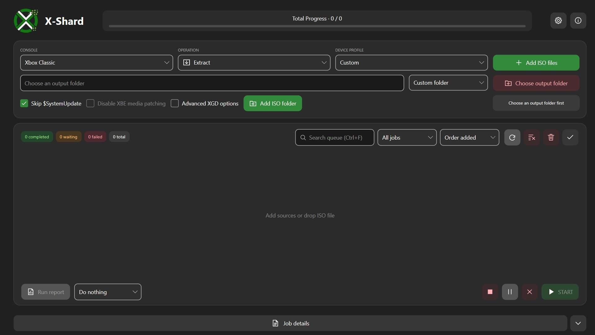

# X-Shard

**X-Shard is an Xbox 360 and Xbox Classic ISO tool for the community.**

Extract, create, inspect and convert Xbox disc images on Windows. Add individual images, source folders or batches of ISO files; choose the console and operation; then process the queue with separate output, logs and a run report. Both conversion backends are included, and the complete Portable or installer release needs no separate .NET runtime installation.

X-Shard does not include games, console firmware or emulator files.



## Highlights

- **Two consoles, one queue** — Xbox Classic and Xbox 360 images, each with the appropriate included backend.
- **Single and batch jobs** — Add images, scan an ISO folder recursively, drop files, or use the Explorer context menu.
- **Flexible operations** — Extract files, create an XISO, inspect contents, rewrite an image or convert supported formats.
- **Title information** — Title ID, name, region, version and icon read directly from the image, without extracting.
- **Device profiles and libraries** — Presets for Xbox Classic, Xbox 360, Xemu and Xenia; output straight into Xemu, Xenia, RetroBat or Batocera game folders; start results in the emulator.
- **Advanced output** — XISO, GoD, CCI, CSO, ZAR and extracted files, with compatible scrub, split and XBE options.
- **Queue control** — Search, filter and sort; start, cancel, stop after the current job, retry, remove or clear; optional hibernate or shutdown afterwards.
- **Preview and reports** — Target preview with space check before a job starts; run reports as TXT or HTML with saved space, duration and errors.
- **Windows integration** — Taskbar progress, a notification when the queue finishes, context menu entries and a command-line tool (`xshard-cli.exe`).
- **Offline by default** — Online title lookups and external links are only used after you confirm them with **Yes**.
- **Desktop customization** — Dark (Windows 11 Mica), Xbox green, light or Windows-matching theme, green default accent, five more colors or the Windows accent, automatic UI scaling for compact displays and six languages with flag buttons.
- **Source protection** — Originals are retained and existing destinations are never overwritten.

## Navigation

| Area | What you'll find |
| --- | --- |
| **Console & Operation** | Console, operation, device profile, output target and output folder, source selection. |
| **Output options** | Format, scrub and compatible image/XBE options for Xbox 360 and advanced workflows. |
| **Queue** | Title icon, source, operation and console, status, duration, progress, output-folder shortcut, search, status filter and sorting. |
| **Queue footer** | Run report export, action after the queue (nothing, hibernate, shut down) and the queue controls. |
| **Job details** | Log, image contents with filter, title information, target preview and **Start in emulator**. Open the card from the footer, or use its arrow for inline details. |
| **Settings** | Backends, emulators and game libraries, storage location, log/report folders, appearance, UI scale, language, notifications, reports, context menu and app reset. |
| **About** | App version, author, project links, backend attribution and licenses. |

Ordinary overlay cards close through their X button or a click on the dimmed background. First-start legal information requires Accept or Decline; Decline exits the application. Press **Ctrl+F** to search the queue.

## Consoles & Device Profiles

### Xbox Classic

Choose **Xbox Classic** for ordinary XISO extraction, creation, listing and rewriting. Advanced conversion enables additional formats and options through the included XGDTool backend.

- **Xbox Classic profile:** extracted output with XBE media/title options.
- **Xbox Classic · Xemu Emulator profile:** full-scrub XISO defaults without split or XBE options.

### Xbox 360

Choose **Xbox 360** to use the included XGDTool backend. Its output options appear automatically as a permanent card.

- **Xbox 360 profile:** full-scrub GoD output defaults.
- **Xbox 360 · Xenia Emulator profile:** full-scrub XISO defaults.

Profiles apply editable presets. Jobs keep the options selected when they are added; changing the current console or profile does not change existing queued jobs. Output compatibility depends on the target console, emulator and game.

## Operations & Files

| Operation | Purpose |
| --- | --- |
| **Extract** | Extract supported image contents into a new output folder. |
| **Create** | Build an XISO from an extracted source folder. |
| **List** | Inspect source contents without producing a converted image. |
| **Rewrite** | Reauthor a working copy of an image while retaining the original. |
| **Convert** | Choose a supported output format for an advanced conversion. |

Choose an output folder before adding a writing job. The output-folder button is red while a destination is required and turns green once a path is set. Add ISO files individually, select an ISO folder for batch scanning, or use a source/game folder for the appropriate operation. Later parts of split images are not added as duplicate batch jobs.

For Xbox Classic extraction, **Skip $SystemUpdate** is enabled by default so the console update folder is not written to the output; clear the checkbox if you need it.

The source path is displayed in each queue row. The folder icon opens that job's output location when available. Removing queue entries or clearing the queue does not delete source or output files.

### Output target and game libraries

Next to the output folder you can choose an **output target**: a custom folder, or the game library of **Xemu** (Xbox Classic), **Xenia** (Xbox 360), **RetroBat** or **Batocera**. Set the library folders once in **Settings › Emulators and game libraries**. RetroBat and Batocera use their `roms\xbox` and `roms\xbox360` folders; Batocera can be reached as a network share such as `\\BATOCERA\share`. For library targets, a single-file result (for example an XISO) is placed directly in the game folder instead of a per-job container folder.

## Output Formats & Options

- **XISO:** disc image output for compatible console and emulator workflows.
- **GoD:** Games on Demand output with the backend-generated container structure preserved.
- **CCI / CSO:** compressed Xbox Classic image workflows.
- **ZAR:** ZArchive output where supported.
- **Extract:** file/folder output.

**Scrub** offers None, Partial or Full where the image writer supports it. Rewrite uses full reauthoring. Split applies to XISO output. Generate attach XBE, allowed-media XBE patching and XBE title renaming are available only for compatible Xbox Classic operations; unavailable options are disabled.

**Offline mode is enabled by default.** Turning it off asks for confirmation (Yes/No) before the backend may use its optional title/artwork lookups (Google, GitHub, XboxUnity). The permission applies only to the current session; X-Shard always starts offline again. Queued jobs that were saved with Offline mode off ask again when you press START — choosing No runs them offline. Offline names may be less accurate. Some upstream lookups use HTTP; leave Offline mode enabled if you do not want those connections.

## Queue, Logs & Contents

Press **START** to process waiting jobs sequentially. Queue progress measures finished jobs, including unsuccessful or cancelled jobs; it is not a success rate. A preparation message with elapsed time provides activity feedback when a backend is quiet. It does not claim an exact analysis percentage or completion time.

Search the queue by name, source or title (**Ctrl+F**), filter it by status and sort it by order added, name or status.

Select a job and open **Job details**:

- **Log** — the processing log; export it as a TXT file when needed.
- **Image contents** — the files of the source, with a filter. The view describes the source, not necessarily the final output after patching or scrub.
- **Title** — Title ID, name, region, version, disc and icon read directly from the image or folder. Xbox Classic: from `default.xbe`. Xbox 360: Title ID, Media ID and region from `default.xex`; name and icon are available for GoD content (Games on Demand header).
- **Target** — where the job will write, the expected folder structure, the estimated size and the free space on the target. Before the queue starts, X-Shard warns if a target drive does not have enough free space.
- **Start in emulator** — starts the result (or the source) in Xemu or Xenia. Set the emulator executables in Settings.

### After the queue

When the queue finishes, X-Shard shows its progress on the taskbar button, flashes the button if the window is in the background and shows a Windows notification (can be turned off in Settings). **Run report** exports a summary of the last run as HTML or TXT — succeeded, failed and cancelled jobs, durations and the space saved by scrubbing or compression. Reports can also be saved automatically to the reports folder.

In the queue footer you can choose to **hibernate** or **shut down** the PC after the queue. A 60-second countdown with **Cancel** appears first. This choice applies to the current session only.

Failed or cancelled work may leave a private `.xshard-*` working folder beside the intended destination. These files are retained for inspection and can be removed manually after processing has stopped.

## Appearance, Language & Storage

The app starts maximized. Auto scaling follows Windows DPI and adapts to the available window size: on compact 11–14" displays the interface is scaled down (to a minimum of 70%) so all cards fit without vertical scrolling; on larger screens it stays at 100% and never enlarges controls just because the window is maximized. Presets and a Custom 100–200% slider let you choose a comfortable size.

Settings › **Appearance** switches between **Dark** (default, neutral gray with the Windows 11 Mica backdrop), **Xbox** (dark green, always with the Xbox green accent), **Light** and **System** (follows Windows). The accent color is green by default; teal, blue, purple, orange, red or the Windows accent color can be chosen; check marks and selections follow the accent.

Settings provides language buttons with flat flag icons for English, German, Spanish, French, Polish and Danish; the active language is highlighted. Additional valid XML translations can be placed in the application's `Localization` folder. Backend logs and supplied legal texts retain their original language.

The folder button beside **Settings and queue location** lets you move preferences, queue data and legal acceptance to a chosen writable folder. X-Shard copies its managed files before switching locations and refuses to overwrite existing X-Shard data at the destination. The old files remain as a backup. Source and output files are not moved. Close other app instances before changing this location.

If X-Shard ever closes unexpectedly, a crash log is written locally; **Open log folder** in Settings shows it. Nothing is uploaded.

**Reset App** restores preferences, clears queue history and resets first-start legal acceptance. It keeps source/output files and the selected storage folder.

## Explorer Context Menu & Command Line

The installer can add **Extract with X-Shard** and **Convert with X-Shard** for ISO files and **Create XISO with X-Shard** for folders to the Explorer context menu (on Windows 11 under *Show more options*). The Portable version offers the same entries for the current user in Settings. If X-Shard is already open, new files are added to the running window.

`xshard-cli.exe` in the program folder runs the same jobs without the window, for scripts and batch files:

```text
xshard-cli extract --output D:\Games "D:\ISO\Game.iso"
xshard-cli convert --console xbox360 --format god --output E:\GoD "D:\ISO\Game.iso"
xshard-cli info "D:\ISO\Game.iso"
xshard-cli help
```

It uses the same settings, backends and offline default (`--online` is required for online lookups) and can write a report with `--report run.html`. The legal documents must be accepted once in X-Shard or with `--accept-eula`.

## Included Backends & Credits

### extract-xiso — XboxDev

X-Shard uses **[extract-xiso](https://github.com/XboxDev/extract-xiso)** for ordinary Xbox Classic XISO workflows. It is maintained by **XboxDev** and was originally written by **in <in@fishtank.com>**. Its original modified Berkeley/BSD-style license and attribution are supplied with the application.

This product includes software developed by in <in@fishtank.com>.

### XGDTool — wiredopposite

**[XGDTool](https://github.com/wiredopposite/XGDTool)** by **wiredopposite** provides Xbox 360 and advanced format conversion. It is distributed under **GNU GPL version 3**. Its original notices and corresponding source accompaniment are included.

The backends are stored in separate subfolders under `backends`. Keep the complete release folder together with its localization, legal, license and source-accompaniment folders. A manual backend path can be chosen in Settings if needed.

X-Shard is an independent project and is not an official Microsoft, XboxDev, XGDTool, Xemu or Xenia product.

## Privacy & Permissions

No cloud account is required. Core processing works offline after installation. Settings, source/output paths, queue metadata and the legal-acceptance hash/timestamp are stored locally in the configured data folder. Exported logs can contain local paths.

X-Shard needs read access to selected sources and write access to output and settings locations. The Windows installer requests administrator permission to install the application under **Program Files**. Normal processing does not require administrator privileges.

External website/repository links (About and links in the legal documents) open in your browser only after you confirm them with **Yes**. Notifications register the app name with Windows for the current user; the context-menu entries are written to the registry only when you enable them. **Reset App** removes the per-user entries again. Optional online backend lookups follow the upstream services' availability and privacy practices. The included EULA, Privacy Policy, Legal Notice, Copyright and license documents explain the applicable terms.

## Important Notes

- Only process files you own or are authorized to use.
- X-Shard does not provide game downloads, physical-disc dumping, firmware modification or decryption.
- A supported extension does not guarantee that every game or image variant will work with every output format or device.
- Keep backups of important files and allow enough free disk space for working copies and output.
- Do not move or remove sources, active output folders or backend files while a job is running.
- A source-project ZIP is intended for developers; use a complete Portable or installer release to run the application directly.

## Project & Copyright

X-Shard is a personal software project by **Sven Klocke** (*complicatiion / sksdesign*).

**Project repository:** [github.com/complicatiion/X-Shard](https://github.com/complicatiion/X-Shard)  
**Website:** [sksdesign.de](https://sksdesign.de/)

Copyright © 2026 Sven Klocke. X-Shard is licensed under **GNU GPL version 3 (GPL-3.0-only)**. Usage, modification and redistribution are governed by that license. Third-party components retain their respective copyright notices and licenses. The supplied legal information does not restrict rights granted by the applicable open-source licenses.
